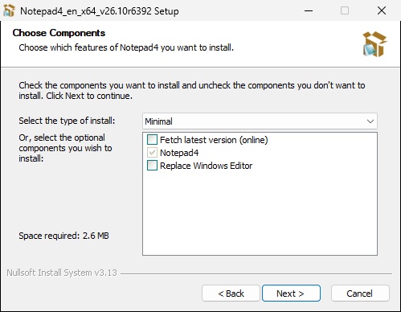
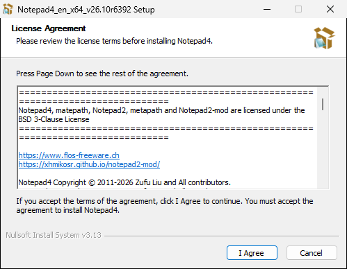
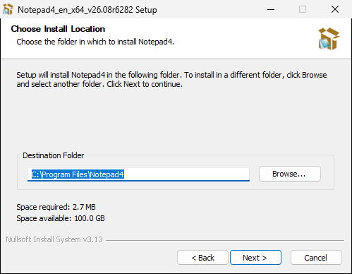
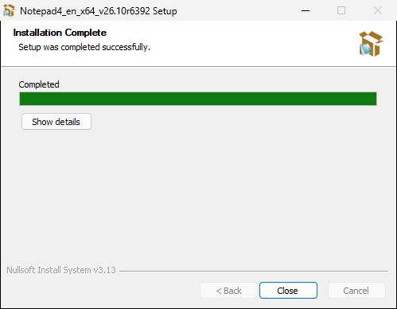

# NSIS Notepad4 Installer

An [NSIS](https://nsis.sourceforge.io/) script that builds a Windows installer for the
[Notepad4](https://github.com/zufuliu/notepad4) binaries (Notepad4 and matepath), with an option to
replace Windows Notepad.



## Features

- Installs Notepad4 and matepath (default folder `C:\Program Files\Notepad4`; an update reuses the
  previous install's folder), with Start menu shortcuts and an Apps & Features entry
- Optional: **Replace Windows Editor** — every `notepad.exe` launch opens Notepad4 (Windows 10/11)
- Optional: **Fetch latest version (online)** — opt-in; queries GitHub for the latest Notepad4 release
  and installs it instead of the bundled one if its tag differs (see [Online update](#online-update)).
  No internet access happens unless you select this option.
- Silent installation support

## Bundled Version

The current installer bundles **Notepad4 v26.10r6392** (English, x64).

## Usage

### Interactive Installation

Run the installer. By default only Notepad4 is selected and the bundled version is installed offline.
The components page offers three install types:

| Install type | Notepad4 | Replace Windows Editor | Fetch latest version (online) |
|---|---|---|---|
| Minimal (preselected) | ✓ | | |
| Typical | ✓ | ✓ | |
| Full | ✓ | ✓ | ✓ |

### Silent Installation

```
notepad4_en_x64_v26.10r6392-install.exe /S /I=full
```

- `/S` — Silent mode (no GUI)
- `/I=full` — also replace Windows Notepad (does not enable the online fetch)
- `/I=minimal` — Notepad4 only (the default; any value other than `full` behaves the same)
- `/UPDATE` — enable the online fetch of the latest version (silent mode only)
- `/D=C:\path\to\Notepad4` — install folder; must be the last parameter and unquoted, even with spaces.
  Without it the previous install's folder is used, else `C:\Program Files\Notepad4`.

## Replace Windows Editor

The section registers `"<install folder>\Notepad4.exe" /z` as the `Debugger` for `notepad.exe`
under `HKLM\SOFTWARE\Microsoft\Windows NT\CurrentVersion\Image File Execution Options`. On Windows 11 it
also removes the Windows Notepad app package (`Get-AppxPackage *Microsoft.WindowsNotepad* | Remove-AppxPackage`)
and adds the IFEO filter entries.

## Online update

The **Fetch latest version (online)** section (or `/UPDATE` in silent mode) extracts two PowerShell
helpers to the installer's temp directory and runs them:

1. [`check_update.ps1`](check_update.ps1) asks the GitHub API for the latest `zufuliu/notepad4` release
   (10 s timeout), picks the first asset matching `Notepad4_en_x64_*.zip` that is not an `HD` build,
   and writes `TagName`, `DownloadURL`, `SHA256` (the asset's `digest` from the API) and `Status`
   (`OK`, `NoAsset` or `Error`) to `%TEMP%\notepad4_update.ini`.
2. If the status is `OK` and the tag differs from `BUNDLED_VERSION`, the installer asks whether to
   download it (silent mode downloads without asking).
3. [`download_update.ps1`](download_update.ps1) downloads the zip (60 s timeout) to
   `%TEMP%\Notepad4_latest.zip` and rejects it unless its SHA-256 equals `SHA256` (a missing digest
   is a rejection too). It extracts the zip to `%TEMP%\Notepad4_latest` (moving the contents of a
   top-level folder up), copies every `*.ini-default` to `*.ini`, and writes `OK` or `FAIL` to
   `%TEMP%\notepad4_download_status.txt`.
4. On `OK` the installer copies the downloaded `Notepad4.exe`, `matepath.exe`, the three `.ini` files
   and `License.txt` over the bundled ones and records the new tag as the version in Apps & Features.
   Otherwise it installs the bundled version (with a message in interactive mode).

The temp files are deleted afterwards.

## Uninstallation

The uninstaller removes the Notepad4 files, Start menu shortcuts and registry entries. If Windows Notepad
was replaced, it is restored (on Windows 11 the Windows Notepad app package is re-registered).

## Building

Compile with NSIS 3 (Windows, or Linux with `apt install nsis`):

```
makensis -WX Notepad4_en_x64_v26.10r6392.nsi
```

This writes `notepad4_en_x64_v26.10r6392-install.exe` next to the script (git-ignored). The script
includes [`psexec.nsh`](psexec.nsh) (PowerShell exec macros) and embeds the two update helpers and
[`Notepad4_Installer.ico`](Notepad4_Installer.ico). CI ([`ci.yml`](.github/workflows/ci.yml)) compiles it
with warnings as errors on every push and pull request, and runs the [E2E](#e2e) suite.

## E2E

[`scripts/e2e.sh`](scripts/e2e.sh) compiles the installer and a fixture build. In the fixture build the
online fetch asks `127.0.0.1:${PORT_BASE:-8765}` instead of the GitHub API. The script then runs these
tests:
- the screenshot tour, as the sweep over every wizard page;
- [`e2e/test-install.ps1`](e2e/test-install.ps1): `/D=` and the previous install folder;
- [`e2e/test-silent.ps1`](e2e/test-silent.ps1): what `/S` and `/I=` install, that `notepad.exe` opens
  Notepad4 after `/I=full`, the uninstaller, and quitting the wizard;
- [`e2e/test-update.ps1`](e2e/test-update.ps1): the online fetch against a local fake of the release
  API, both silent and in the wizard (including its two message boxes);
- [`e2e/test-download.ps1`](e2e/test-download.ps1): the SHA-256 check of the download.

[`e2e/COVERAGE.md`](e2e/COVERAGE.md) maps every feature to its test.

The tests really install Notepad4, replace Windows Notepad for a while and uninstall again. They
therefore run only on throwaway Windows machines, and refuse to start without `E2E_INSTALL=1`. CI's `e2e`
job runs them on windows-2022 and windows-2025, which cover the pre-Windows 11 branch and the
Windows 11 branch of the installer. On a disposable Windows VM with Git Bash, NSIS and Python on `PATH`,
run `E2E_INSTALL=1 bash scripts/e2e.sh`. Output goes to `$ARTIFACTS`. Anywhere else the script stops
after the two compiles.

## Updating to a new Notepad4 release

The version is part of the script name, the payload folder name and two defines; the installer file name
follows from them.

1. Download `Notepad4_en_x64_<version>.zip` (not the `HD` build) from the
   [Notepad4 releases](https://github.com/zufuliu/notepad4/releases) and check its SHA-256 against the
   release asset digest.
2. `git mv Notepad4_en_x64_<old> Notepad4_en_x64_<new>` and replace its six files with the zip's
   `Notepad4.exe`, `matepath.exe`, `License.txt` and the `*.ini-default` files renamed to `*.ini`
   (`Notepad4.ini`, `matepath.ini`, `Notepad4 DarkTheme.ini`). Give `License.txt` a UTF-8 BOM
   (`printf '\xef\xbb\xbf' | cat - License.txt > l && mv l License.txt`), otherwise the license page
   shows `©`; the screenshot tour checks it. If the release's file set changed, adjust the `File`,
   `CopyFiles` and `Delete` lines in the script.
3. `git mv Notepad4_en_x64_<old>.nsi Notepad4_en_x64_<new>.nsi` and update the defines at the top:
   `BUNDLED_VERSION` must equal the GitHub release tag exactly (e.g. `v26.10r6392`; the online fetch
   compares the two), `RELEASEVERSION` is `en_x64_<tag>`.
4. Replace every `<old>` in this README (`grep -n <old> README.md`): bundled version, silent-install and
   build output file names, build command, `License.txt` link.
5. `makensis -WX Notepad4_en_x64_<new>.nsi` must pass. The workflows find the script as
   `Notepad4_en_x64_*.nsi` and need no change.

## Screenshots





All installer and uninstaller pages: [docs/screenshots](docs/screenshots/README.md).

The images come from an automated tour: [`scripts/docs-screenshots.sh`](scripts/docs-screenshots.sh) compiles
the installer and runs [`scripts/docs-tour.ps1`](scripts/docs-tour.ps1), which clicks through every page via
UI Automation, checks each page's heading and captures the window. The tour really installs and uninstalls
Notepad4, so it only runs on throwaway Windows machines and refuses to start without `DOCS_TOUR_INSTALL=1`.

To regenerate: Actions → **Docs screenshots** → Run workflow, unzip the `docs-screenshots` artifact into
`docs/screenshots/`, run `oxipng -o 4 --strip safe docs/screenshots/*.png`, review the diff and commit.
On a disposable Windows VM with Git Bash and NSIS on `PATH`: `DOCS_TOUR_INSTALL=1 bash scripts/docs-screenshots.sh`.
CI runs the same tour as part of the [E2E](#e2e) suite on every push (artifacts `e2e-windows-*`, folder `screenshots/`).

## License

The installer script is MIT-licensed ([LICENSE](LICENSE)). Notepad4 and matepath are distributed under
their own license, shown on the installer's first page
([`License.txt`](Notepad4_en_x64_v26.10r6392/License.txt)).
