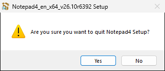
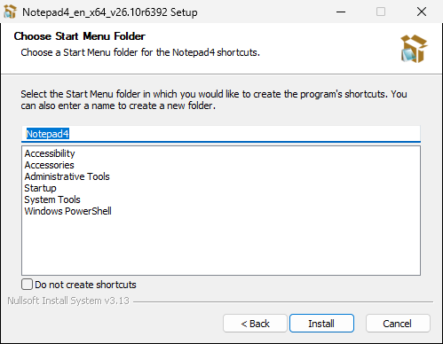
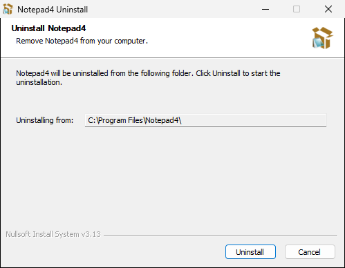
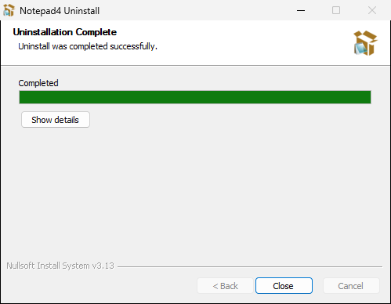

# Screenshots

Every page of the installer and uninstaller wizard, captured by the automated tour
(`scripts/docs-screenshots.sh`, see the main [README](../../README.md#screenshots)).

## License agreement

The first page shows the Notepad4 license bundled with the release; **I Agree** continues.

## Cancel confirmation

Cancel asks before quitting the setup.

## Components

Notepad4 (with matepath) is always installed. **Replace Windows Editor** and **Fetch latest version
(online)** are opt-in; the install type list switches between Minimal (preselected), Typical and Full.

## Install location

Defaults to the previous install's folder, else `C:\Program Files\Notepad4`. (The tour pins the machine-dependent "Space available" to 100.0 GB.)

## Start menu folder

Folder for the Notepad4 and matepath shortcuts; the list shows the machine's existing Start menu folders
(the tour pins it to a few standard Windows folders).

## Installation complete

## Uninstall

The uninstaller (Apps & Features → Notepad4) confirms the folder before removing it.

## Uninstall complete

If Windows Notepad was replaced, it has been restored at this point.

